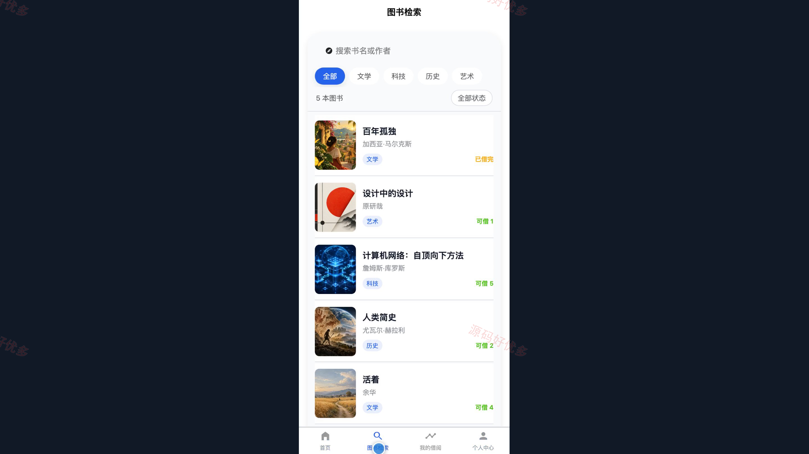
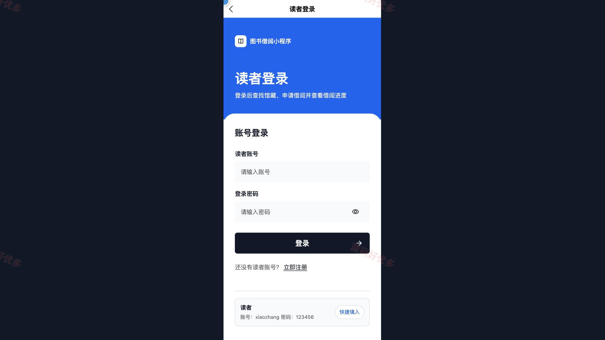
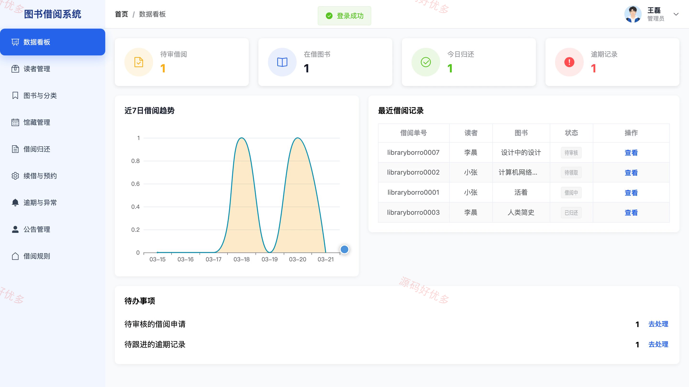
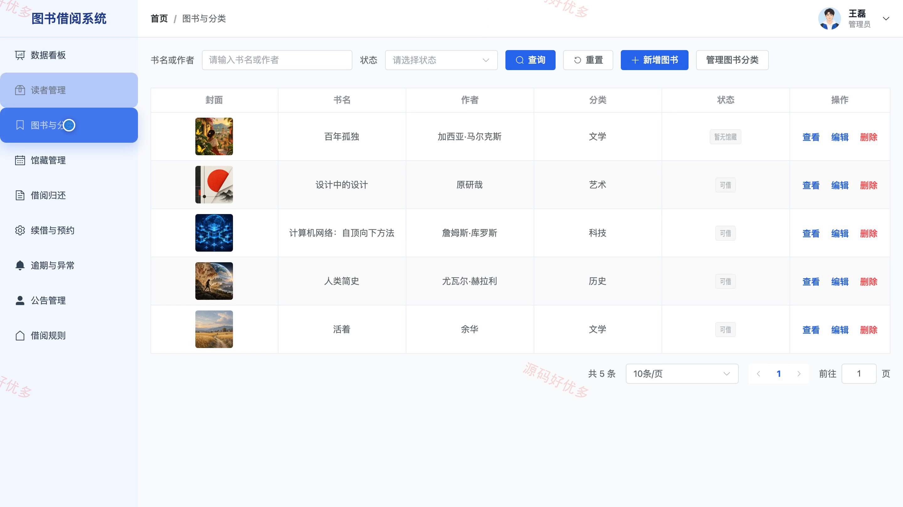
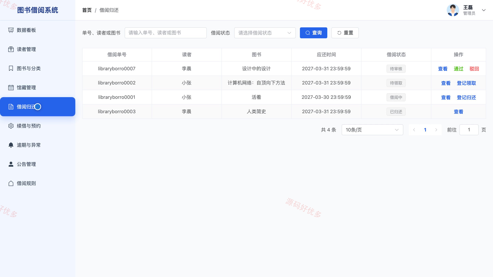

## 源码问题查看主页咨询

### 一、关键词
图书借阅、智慧图书馆、馆藏检索、读者服务、图书预约

### 二、作品包含
源码+数据库+万字设计文档+PPT+全套环境和工具资源+本地部署教程

### 三、项目技术
前端技术： Html、Css、Js、Vue3.4、Element-Plus、uniapp
后端技术：Java、SpringBoot3.2.0、MyBatis-Plus

### 四、运行环境要求
开发工具：IDEA/eclipse + VSCODE + HBuilder X + 微信开发者工具

数据库：MySQL5.7+（共13张表）

数据库管理工具：Navicat10以上版本

环境配置软件： JDK17 + Maven3.6

前端Nodejs：20.20.2

浏览器：谷歌浏览器

### 五、项目介绍
项目编号：bs122B

图书借阅小程序面向读者提供馆藏检索、借阅申请、预约、续借和收藏服务，管理员通过后台维护图书、馆藏、借阅记录与公告。

角色：管理员、用户

管理员功能：查看借阅数据看板、管理读者账号、维护图书分类与馆藏、处理借阅归还与续借预约、管理逾期异常记录、发布公告与维护借阅规则。

用户功能：检索馆藏并查看图书详情、提交借阅与预约申请、查看借阅记录并申请续借、收藏和取消收藏图书、查看公告与维护个人资料。

### 六、运行截图

